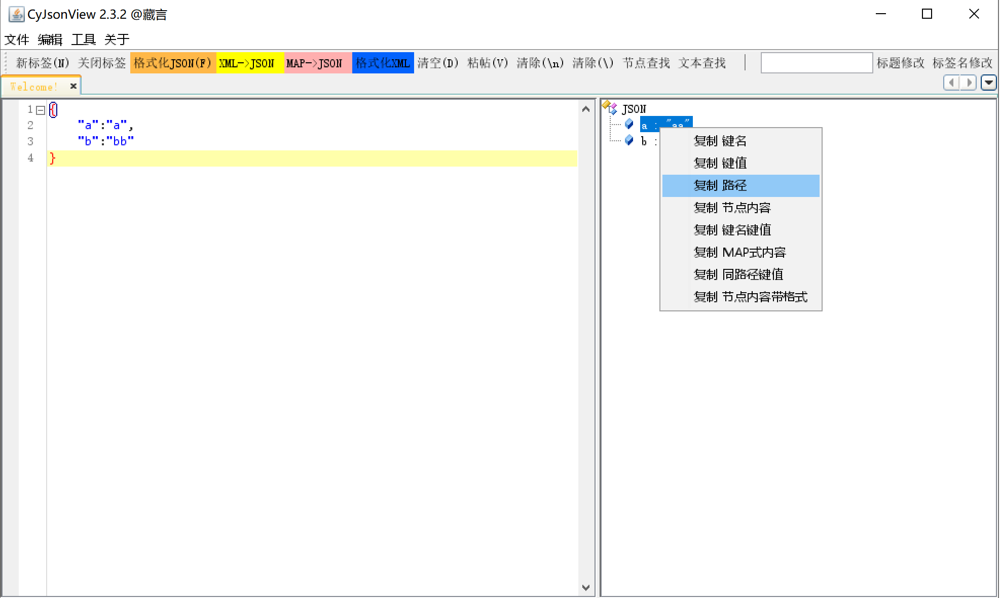

# JsonView

#### 介绍
一个JSON格式化查看工具，支持JSON和XML的格式化、解析和可视化展示。

- 支持JSON格式化和美化
- 支持XML格式化和转换为JSON
- 提供树形结构可视化展示
- 支持语法高亮显示

可执行文件在 `/JsonView/bin` 目录

联系方式：邮箱beetle082@163.com，qq:275951533

**源码地址**<br/>
https://gitee.com/beetle082/JsonView <br/>
https://github.com/hao117/JsonView<br/>


---

## 依赖说明

### 公共依赖（Maven Central）
| 依赖 | 版本 | 说明 |
|------|------|------|
| dom4j:dom4j | 1.6.1 | XML解析库 |
| com.alibaba:fastjson | 1.2.75 | JSON处理库 |
| commons-lang:commons-lang | 2.6 | Apache工具类库 |

### 本地依赖（需手动安装）
以下依赖不在Maven Central，需要先执行 `lib/install.bat` 安装到本地Maven仓库：

| 依赖 | 版本 | 说明 |
|------|------|------|
| com.fifesoft:rsyntaxtextarea | 2.6.1 | 语法高亮文本组件 |
| org.netbeans:org-netbeans-swing-tabcontrol | 200804211638 | NetBeans Swing标签组件 |
| org.netbeans:org-openide-awt | 200804211638 | NetBeans OpenIDE AWT工具 |
| org.netbeans:org-openide-util | 200804211638 | NetBeans OpenIDE工具类 |
| org.netbeans:org-openide-windows | 200804211638 | NetBeans OpenIDE窗口系统 |

#### 安装本地依赖
```bash
cd lib
install.bat
```

### 测试依赖
| 依赖 | 版本 | 说明 |
|------|------|------|
| junit:junit | 4.13.2 | 单元测试框架 |

---

## 构建与运行

### 环境要求
- JDK 1.8+
- Maven 3.6+

### 编译运行
```bash
# 安装本地依赖（首次运行）
cd lib && install.bat

# 编译项目
mvn compile

# 打包项目
mvn package

# 运行程序
java -jar bin/JsonView.jar
```

---

## 测试说明

### 单元测试
项目使用JUnit 4进行单元测试，测试代码位于 `src/test/java` 目录。

### 运行测试
```bash
# 运行所有单元测试
mvn test

# 查看测试报告
# 测试报告位于 target/surefire-reports/ 目录
```

### 测试覆盖范围
测试覆盖了核心工具类 `Kit.java` 的主要业务逻辑：
- JSON/XML字符串处理
- 树形节点创建
- 格式化方法
- 索引和键值处理
